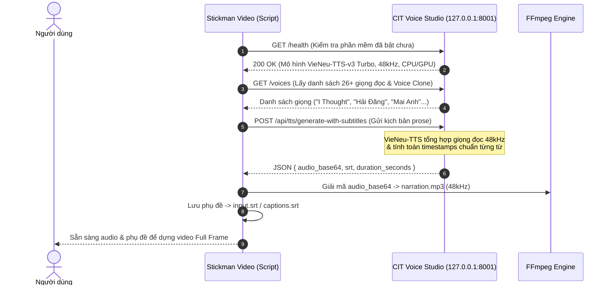

# Cầu Nối CIT Voice Studio Đa Ngôn Ngữ (VieNeu-TTS Tiếng Việt & Kokoro Tiếng Anh)

Hệ thống kết nối trực tiếp với phần mềm **CIT Voice Studio** đang chạy trên máy tính (`http://127.0.0.1:8001`), tự động hóa 100% quy trình thu âm giọng đọc phòng thu 48.000 Hz và xuất file phụ đề SRT đồng bộ tuyệt đối từng mili-giây cho **cả 2 kênh Tiếng Việt và Tiếng Anh**:

| Kênh | Cờ CLI | Model Trên CIT Voice Studio | Giọng Mặc Định | Chốt Kiểm Tra An Toàn (Guardrail) |
| :--- | :---: | :--- | :--- | :--- |
| 🇻🇳 **Tiếng Việt** | `--lang vi` | **VieNeu-TTS-v3-Turbo** | `Văn Hải` (`CIT_VOICE`) | Chặn lỗi nếu phần mềm đang bật `Kokoro` |
| 🇺🇸 **Tiếng Anh** | `--lang en` | **Kokoro** | `auto` / `CIT_EN_VOICE` (vd: `am_michael`, `bm_george`) | Chặn lỗi & nhắc chuyển Model sang `Kokoro` nếu đang ở `VieNeu-TTS` |

---

## 1. Sơ Đồ Kiến Trúc Kết Nối (Local HTTP Bridge + Model Guardrail)



---

## 2. Cấu Hình Tùy Chỉnh (File `.env`)

Cấu hình máy chủ và giọng đọc mặc định trong file `.env` ở thư mục gốc hoặc thư mục skill:

```ini
# CIT Voice Studio Configuration (Dual-Model: VieNeu-TTS for VI & Kokoro for EN)
CIT_BASE_URL=http://127.0.0.1:8001
CIT_VOICE=Văn Hải
CIT_EN_VOICE=auto
CIT_SPEED=1.0
```

- **`CIT_BASE_URL`**: Địa chỉ máy chủ cục bộ (mặc định: `http://127.0.0.1:8001`).
- **`CIT_VOICE`**: Tên giọng Tiếng Việt cho Model `VieNeu-TTS` (mặc định: `Văn Hải`).
- **`CIT_EN_VOICE`**: Tên giọng Tiếng Anh cho Model `Kokoro` (mặc định: `auto` — tự chọn giọng nam trầm từ `/voices` như `am_michael`, `am_adam`, `bm_george`, hoặc chỉ định trực tiếp tên giọng anh thích).
- **`CIT_SPEED`**: Tốc độ đọc (mặc định: `1.0`).

---

## 3. Dữ Liệu Gửi Đi & Nhận Về

### Endpoint: `POST http://127.0.0.1:8001/api/tts/generate-with-subtitles`

**Gói tin gửi đi (JSON)**:
```json
{
  "text": "Đã bao giờ bạn cố ngồi xem hết một bộ phim cực kỳ nhàm chán...",
  "voice_id": "Văn Hải",
  "speed": 1.0,
  "format": "wav"
}
```

**Phản hồi nhận về (JSON)**:
- `audio_base64`: Chuỗi Base64 chứa dữ liệu âm thanh phòng thu 48.000 Hz nguyên bản.
- `srt`: Nội dung file phụ đề SRT với timestamps khớp từng mili-giây với giọng đọc.
- `duration_seconds`: Tổng thời lượng chính xác của file âm thanh (làm căn cứ phân chia cảnh cho video).

---

## 4. Lệnh Sử Dụng (CLI & Code)

### Cách 1 · Dùng script Python chuẩn (`generate_voice_cit.py`)
Script sử dụng thư viện chuẩn `urllib.request` của Python, không cần cài thêm package nào:

```bash
# 1. Kiểm tra trạng thái & Model hiện tại của CIT Voice Studio
python scripts/generate_voice_cit.py --check-health

# 2. Xem danh sách giọng đọc của Model đang bật (VieNeu-TTS hoặc Kokoro)
python scripts/generate_voice_cit.py --list-voices

# 3A. Thu âm Kênh Tiếng Việt (Model VieNeu-TTS)
python scripts/generate_voice_cit.py \
    --lang vi \
    --script-file projects/vi/<tên-dự-án>/script.md \
    --project-dir projects/vi/<tên-dự-án> \
    --voice "Văn Hải"

# 3B. Thu âm Kênh Tiếng Anh (Chuyển Model CIT Voice Studio sang Kokoro trước)
python scripts/generate_voice_cit.py \
    --lang en \
    --script-file projects/en/<project-slug>/script.md \
    --project-dir projects/en/<project-slug> \
    --voice auto
```

### Cách 2 · Dùng qua `scene-studio.mjs` (Node.js)
```bash
# Kiểm tra kết nối CIT Voice Studio
node skills/directing-stickman-videos/scripts/scene-studio.mjs cit-health

# Tạo giọng đọc và phụ đề (Tiếng Việt)
node skills/directing-stickman-videos/scripts/scene-studio.mjs voice-cit projects/vi/<slug>/script.md projects/vi/<slug> --lang vi --voice "Văn Hải"

# Tạo giọng đọc và phụ đề (Tiếng Anh - Model Kokoro)
node skills/directing-stickman-videos/scripts/scene-studio.mjs voice-cit projects/en/<slug>/script.md projects/en/<slug> --lang en --voice auto
```

---

## 5. Danh Sách Giọng Đọc Tiêu Biểu Trong CIT Voice Studio

| Tên Giọng | Vùng miền / Phong cách | Tần số lấy mẫu | Loại giọng |
| :--- | :--- | :---: | :--- |
| **I Thought** | Nam · Bắc · Phong cách tự nhiên, sâu lắng | 48.000 Hz | Cloned (Đặc quyền) |
| **Hải Đăng** | Nam · Bắc · Tự nhiên, rõ ràng | 48.000 Hz | Gốc |
| **Thiện Minh** | Nam · Bắc · Kể chuyện truyền cảm | 48.000 Hz | Gốc |
| **Mai Anh** | Nữ · Bắc · Tin tức, chuẩn mực | 48.000 Hz | Gốc |
| **Trúc Ly** | Nữ · Bắc · Tự nhiên, nhẹ nhàng | 48.000 Hz | Gốc |
| **Thùy Dung** | Nữ · Nam · Tin tức, hiện đại | 48.000 Hz | Gốc |
| **Thái Sơn** | Nam · Nam · Kể chuyện, trầm ấm | 48.000 Hz | Gốc |
| **Văn Hải** | Nam · Bắc · Tự nhiên, đĩnh đạc | 48.000 Hz | Cloned |
