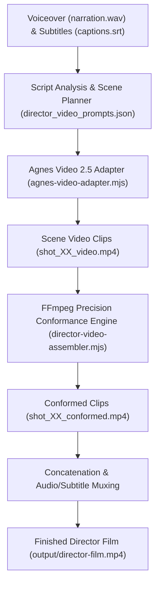

# Director Mode Video Generation Pipeline (Agnes Video 2.5)

## Overview

Upgraded **Director Mode (Mode A)** automates the transformation of a narrated, subtitled script into a fully animated video film using **Agnes AI Video 2.5** models (`agnes-video-2.5-flash` or `agnes-video-2.5`).

Instead of static frame cuts, each scene is rendered as an independent animated video clip that is dynamically conformed to match the exact millisecond duration of its spoken audio and subtitle cues, then seamlessly stitched together with narration and burned-in subtitles.

---

## Architectural Flow



---

## Core Components

### 1. Agnes Video Adapter (`skills/directing-stickman-videos/scripts/agnes-video-adapter.mjs`)
- Communicates with Agnes AI Video API endpoints:
  - Task submission: `POST https://apihub.agnes-ai.com/v1/videos`
  - Task polling: `GET https://apihub.agnes-ai.com/v1/videos/:taskId`
- Supported Models:
  - `agnes-video-2.5-flash` (free-tier / shared queue)
  - `agnes-video-2.5` (pro-tier, requires account quota)
- Automatic retry with exponential backoff on `503` (queue full) or `429` (rate limits).
- Incremental caching: automatically skips already generated shots.

### 2. Duration Conformance Engine (`scripts/director-video-assembler.mjs`)
- Uses `ffprobe` to measure the source clip duration.
- Conforms each video clip to the exact target duration of the spoken audio cue:
  - Mild duration delta (0.75x - 1.35x): applies continuous smooth `setpts` retiming.
  - Video longer than target: trims cleanly at target duration.
  - Video shorter than target: retimes up to 1.25x and uses `tpad=stop_mode=clone` to freeze-hold the final character pose.
- Standardizes video format: 1920x1080 (16:9), 30fps, `yuv420p`, solid white background padding.

### 3. Subtitle & Audio Muxer (`scripts/director-video-assembler.mjs`)
- Conforms SRT subtitles with safe line lengths to prevent edge clipping.
- Muxes audio track with AAC 192k audio.
- Burns in hardcoded styled subtitles (clean white typography with black outlines and shadow).

### 4. Master Orchestration CLI (`scripts/director-video-pipeline.mjs`)
- Command-line runner for batch execution, pilot testing, and assembly.

---

## CLI Usage

### Generate Full Film
```bash
node scripts/director-video-pipeline.mjs --project projects/people-pleasing
```

### Pilot Run (Generate 1-2 Sample Shots Only)
```bash
node scripts/director-video-pipeline.mjs --project projects/people-pleasing --shots 1,2 --output pilot-preview.mp4
```

### Select Pro Model (Requires Agnes AI Quota)
```bash
node scripts/director-video-pipeline.mjs --model agnes-video-2.5
```

### Re-Assemble Existing Clips Without Calling API
```bash
node scripts/director-video-pipeline.mjs --project projects/people-pleasing --skip-gen
```
